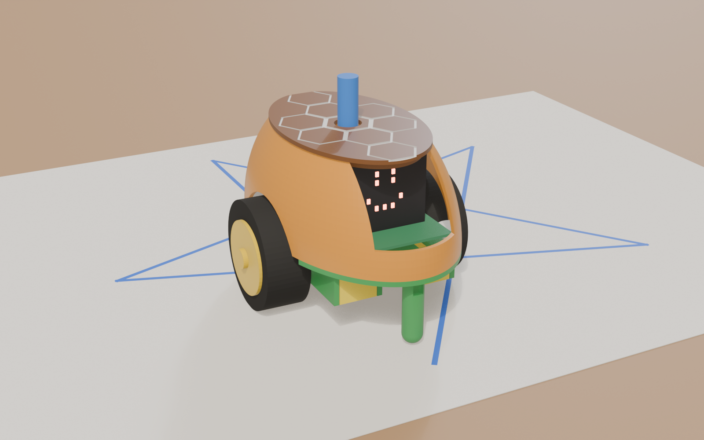

# Projet Canopé – Kit de robotique pour les écoles de Corse

**Problématique :** comment concevoir un kit de robotique à faible coût, robuste et transportable pour les écoles de Corse ?

Le kit doit permettre aux enseignants de proposer des activités de découverte de la robotique, même sans laboratoire spécialisé ni budget important.

## Étapes du projet

1. **Comprendre le besoin** : étudier les écoles corses, les contraintes des enseignants et les besoins des élèves.
2. **Effectuer les recherches** : étudier les robots existants, les composants, les matériaux et les prix.
3. **Réaliser le document de veille** : classer les informations et comparer les solutions techniques.
4. **Imaginer plusieurs concepts** : dessiner plusieurs robots, boîtiers et mallettes.
5. **Comparer les résultats** : évaluer le prix, la solidité, le poids, la facilité d'utilisation et la pédagogie.
6. **Améliorer et finaliser** : choisir la meilleure solution et concevoir le kit définitif.

## Les 5 enjeux

| Enjeu | Question |
|---|---|
| Coût | Comment réduire le prix sans sacrifier la qualité des composants ? |
| Robustesse | Comment protéger l'électronique contre les chocs, les manipulations répétées et l'usure ? |
| Transport | Comment concevoir un kit compact, léger et facile à déplacer ? |
| Pédagogie | Comment rendre la robotique accessible aux élèves et aux enseignants ? |
| Autonomie | Comment utiliser le kit sans matériel coûteux ni connaissances techniques avancées ? |

## Documents

- [Questions de recherche pour le Réseau Canopé](docs/questions-recherche-canope.md)
- [Veille : cartes électroniques](docs/veille-cartes-electroniques.md)
- [Tartaruga : robot tortue imprimable en 3D](modeles-3d/README.md)

## Modélisation 3D (Blender)

Le fichier `.mcp.json` déclare le serveur MCP [blender-mcp](https://github.com/ahujasid/blender-mcp). Il permet à Claude Code de piloter Blender pour modéliser les robots et les mallettes. Il ne fonctionne qu'en local, sur l'ordinateur où Blender est ouvert :

1. Installer `uv` (qui fournit la commande `uvx`).
2. Dans Blender, installer l'extension `addon.py` du dépôt blender-mcp (*Edit > Preferences > Add-ons > Install*), puis l'activer.
3. Dans la barre latérale de la vue 3D (touche `N`), onglet **BlenderMCP**, cliquer sur **Connect to Claude**.
4. Lancer Claude Code dans ce dossier et accepter le serveur MCP `blender`.
