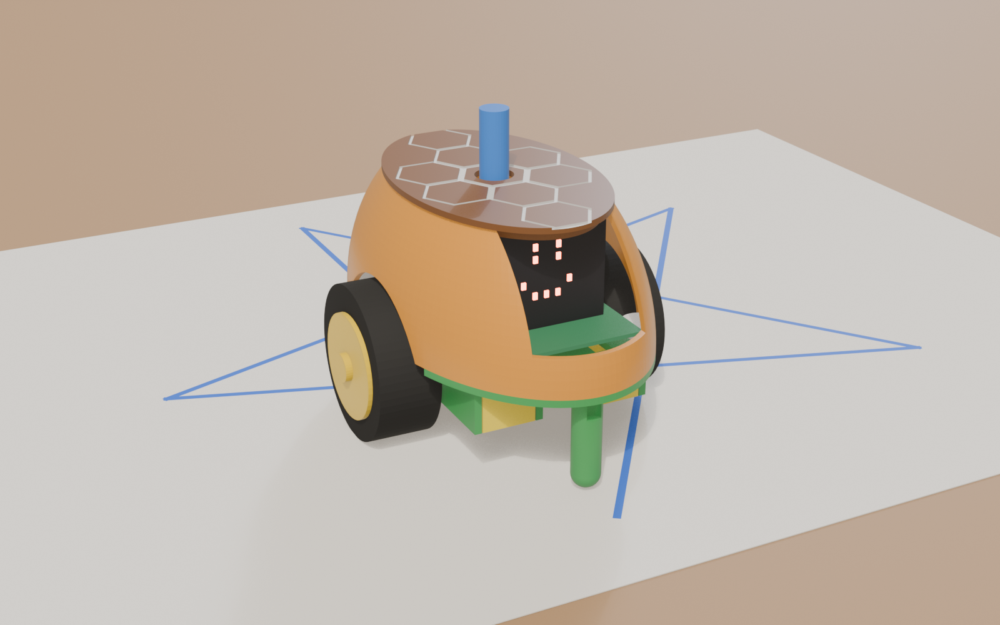
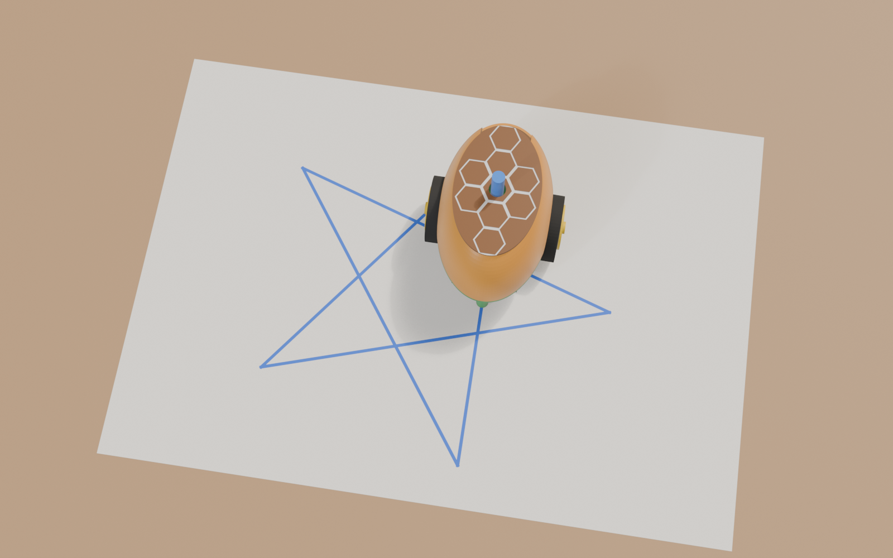
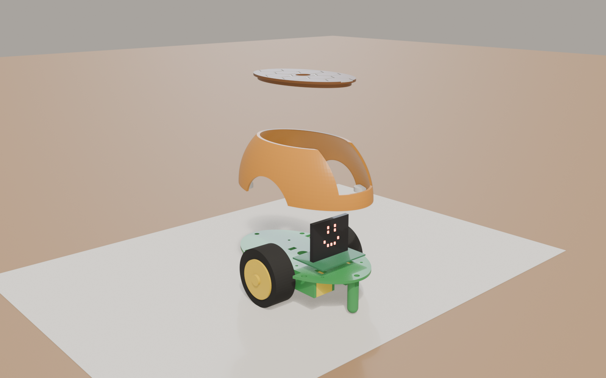
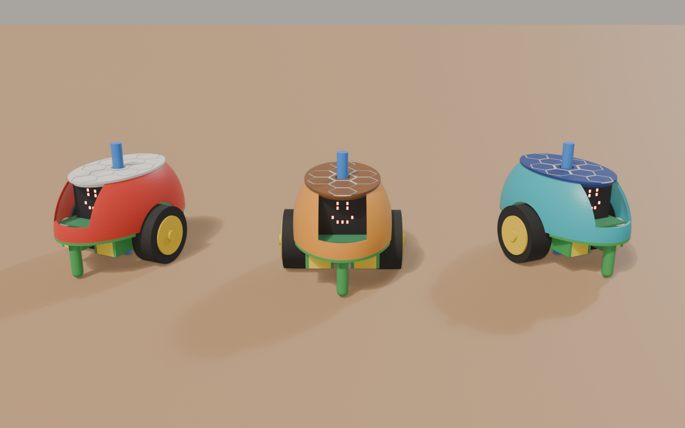

# Tartaruga – robot tortue imprimable

Robot inspiré de la **tortue d'Hermann**, une espèce emblématique de Corse. Il est conçu pour le **micro:bit V2** avec une carte d'extension robot, et se programme en blocs de style Scratch (MakeCode, Vittascience), du CM2 à la 5e.

| Elle dessine | On voit l'intérieur | On personnalise sa carapace |
|---|---|---|
|  |  |  |

*Rendus 3D réalisés dans Blender. L'électronique (moteurs, carte, micro:bit) y est simplifiée.*

🎬 **[Voir la vidéo : Tartaruga dessine une étoile](../videos/tartaruga_dessine_une_etoile.mp4)** (23 s). La tortue trace une étoile à 5 branches, lève son stylo, puis repart avec un cœur sur son visage de LED. Le fichier `tartaruga_animation.blend` permet de refaire ce rendu.

## Ce qui le rend ludique

- **Elle dessine.** Un feutre se place au centre, entre les deux roues. La tortue trace ses déplacements comme la tortue du langage Logo : carré, triangle, étoile… C'est de la géométrie de cycle 3 et 4.
- **Elle lève son stylo.** Un petit servomoteur soulève le feutre : la tortue peut se déplacer sans tracer, pour dessiner des figures séparées, des lettres ou des pointillés.
- **Elle a un visage.** Une fenêtre à l'avant laisse voir les LED du micro:bit, qui affichent des émotions ou des flèches.
- **On change sa carapace.** La carapace tient par des aimants et s'enlève sans outil. Le couvercle est plat, donc les élèves peuvent dessiner le leur, par exemple dans Tinkercad.
- **On voit l'intérieur.** En enlevant la carapace, on découvre les moteurs, les piles et la carte.

## Pièces à imprimer

Les fichiers STL sont déjà orientés pour l'impression. Toutes les pièces tiennent sur un plateau de 220 × 220 mm.

| Fichier | Dimensions (mm) | Orientation | Supports |
|---|---|---|---|
| `tartaruga_chassis.stl` | 99 × 180 × 44 | posé sur sa face plate (le dessus du châssis) | non |
| `tartaruga_carapace.stl` | 105 × 180 × 56 | posée sur son bord | non (pente de 50° au plus) |
| `tartaruga_couvercle.stl` | 81 × 130 × 6,5 | face gravée contre le plateau | non |
| `tartaruga_support_leve_stylo.stl` | 56 × 38,5 × 15 | posé sur sa base | non |
| `tartaruga_bague_feutre.stl` | 23 × 40 × 8 | posée à plat | non |

**Matériau conseillé : PETG**, pour le châssis, la carapace, le support du servo et la bague. Le PLA commence à se ramollir vers 50 à 60 °C, une température qu'une voiture au soleil peut atteindre en été. Le PLA convient en revanche aux couvercles personnalisés par les élèves. Voir la [veille sur les matériaux](../docs/veille-energie-materiaux-programmation.md).

**Réglages conseillés :** buse de 0,4 mm, couches de 0,2 mm, 3 périmètres, remplissage de 20 %. Pour le châssis, 4 périmètres rendent les berceaux moteurs plus solides.

`tartaruga.blend` contient le modèle complet, avec les composants de référence (moteurs, roues, piles, carte) dans une collection à part.

## Matériel à acheter

| Composant | Quantité |
|---|---|
| BBC micro:bit V2 | 1 |
| Carte d'extension robot pour micro:bit (pilote 2 moteurs **et au moins 1 sortie servo**, avec extension MakeCode ou Vittascience) | 1 |
| Moteur TT jaune avec réducteur, et sa roue de 65 mm | 2 |
| Micro-servomoteur SG90 avec palonnier simple | 1 |
| Bloc 4 piles AA (format 2 × 2, environ 63 × 58 × 16 mm) | 1 |
| Aimants néodyme 6 × 3 mm | 12 (6 dans le châssis, 6 dans la carapace) |
| Vis M3 × 8 et entretoises nylon M3 × 8 | 4, pour la carte |
| Vis M3 × 16 et écrous M3 | 2, qui tiennent à la fois le bloc de piles et le support du servo |
| Vis M2 auto-taraudeuses (livrées avec le SG90) | 2, pour le servo |
| Vis M3 × 6 pour serrer la bague sur le feutre | 1 |
| Colliers de serrage, 3 mm de large | 4 (2 par moteur) |
| Feutre, 12 mm de diamètre au plus | 1 |

## Coût estimé par robot

Estimation faite en novembre 2026, à partir de prix relevés en ligne, TTC. **Les prix changent souvent : à revérifier avant toute commande.**

| Composant | Version de marque | Version économique |
|---|---|---|
| micro:bit V2 (prix en pack de 10) | 20 € | 20 € |
| Carte d'extension moteur | 15 € (Kitronik) | 8 € (générique) |
| 2 moteurs TT avec roues de 65 mm | 11 € | 5 € |
| Micro-servomoteur SG90 (lève-stylo) | 6 € (à l'unité) | 1,80 € (en lot de 10) |
| Boîtier 4 piles AA et 4 piles alcalines | 4,50 € | 3 € |
| 12 aimants néodyme 6 × 3 mm | 1,50 € | 1 € |
| Vis, entretoises, colliers | 1,20 € | 0,70 € |
| Feutre | 1 € | 0,50 € |
| Filament PLA (≈ 135 g à 20 €/kg) | 2,70 € | 2,70 € |
| **Total par robot** | **≈ 63 €** | **≈ 43 €** |

Pour le coût d'un kit complet pour une classe (8 ou 12 robots, rechanges, mallette), voir le [chiffrage du kit de classe](../docs/chiffrage-kit-classe.md).

**D'où viennent les chiffres :**
- **Filament :** le châssis, la carapace et le couvercle font 135 cm³ s'ils étaient pleins (mesuré dans Blender). Avec 20 % de remplissage et des parois fines, il faut compter environ 110 à 130 g de PLA, plus une dizaine de grammes pour le support du servo et la bague.
- **Servomoteur SG90 :** environ 5 à 6 € à l'unité chez un revendeur français, environ 1,80 € pièce en lot de 10 ([RS France](https://befr.rs-online.com/web/p/stem-motion-components/2153180), [lot de 10](https://www.fruugo.fr/lot-de-10-servomoteurs-micro-servo-sg90-9g-pour-avion-180%25C2%25B0/p-364895706)).
- **Temps d'impression :** environ 8 h par robot. C'est une estimation, à confirmer avec le logiciel d'impression (le « slicer »).

**Ce qui n'est pas compté :**
- la livraison vers la Corse (certains vendeurs facturent environ 18 € sous 50 € de commande) ;
- l'achat d'une imprimante 3D ;
- des piles rechargeables (environ 10 € les 4, plus un chargeur), si on les préfère aux piles jetables.

**Pour comparer :** les robots éducatifs du commerce (mBot, Thymio) coûtent plutôt 80 à 150 € pièce. Cet ordre de grandeur reste à vérifier pendant la veille sur le budget. Tartaruga reviendrait donc environ 2 à 3 fois moins cher.

**Pour faire baisser le prix :** commander les micro:bit en pack Club de 10, et les moteurs et cartes génériques en lot. Une pièce imprimée cassée se refait pour quelques dizaines de centimes.

**Sources :**
- [micro:bit V2 à l'unité (RS France)](https://fr.rs-online.com/web/p/bbc-micro-bit/2336797) et [pack Club](https://fr.rs-online.com/web/p/bbc-micro-bit/2336795)
- [Kitronik Compact Motor Driver (RS)](https://befr.rs-online.com/web/p/bbc-micro-bit-add-ons/2048223)
- [Waveshare Driver Breakout for micro:bit](https://www.waveshare.com/product/mcu-tools/development-boards/motors-interface/motor-driver-for-micro-bit.htm)
- [Dagu : 2 roues de 65 mm et 2 moteurs TT (RobotShop)](https://eu.robotshop.com/products/dagu-65mm-wheel-pair-tt-3-6v-dc-gear-motor)
- [Roues de 65 mm (Kiwi Electronics)](https://www.kiwi-electronics.com/en/robotics-kits-parts-177/wheel-65mm-rubber-tire-pair-3243)

## Montage

1. Glissez chaque moteur dans son berceau, sous le châssis, et serrez-le avec 2 colliers passés dans les fentes.
2. Placez le bloc de piles sous l'arrière du châssis et le support du servo au-dessus, puis serrez l'ensemble avec 2 vis M3 × 16 et leurs écrous. Faites passer les fils des piles par la fente.
3. Couchez le servo SG90 sur son support, axe tourné vers le tube du feutre, et vissez ses pattes sur les deux poteaux (vis M2). Mettez le palonnier simple, bras dirigé vers l'avant.
4. Fixez la carte d'extension sur le dessus avec 4 entretoises M3, puis insérez le micro:bit, LED vers l'avant. Branchez les moteurs et le servo sur la carte.
5. Collez les aimants dans le châssis et dans les pattes de la carapace. **Vérifiez les pôles** : chaque paire doit s'attirer.
6. Glissez le feutre par le haut, à travers le tube, jusqu'à ce que la pointe touche le papier. Il doit coulisser librement.
7. Enfilez la bague sur le feutre, languette tournée vers le servo. Mettez le servo en position « stylo baissé » (bras à l'horizontale), placez la languette juste au-dessus du bras, puis serrez la vis M3 de la bague.
8. Posez la carapace, puis le couvercle.

**Lever et baisser le stylo :** dans MakeCode ou Vittascience, faites tourner le servo d'environ 25° pour lever le feutre de 6 mm environ, puis revenez à la position de départ pour le baisser. Les angles exacts sont à régler à l'essai.

## À vérifier avant d'imprimer

Ces cotes viennent de valeurs courantes. **Mesurez vos composants au pied à coulisse.** Si une cote diffère, le modèle doit être régénéré avec la bonne valeur :

- **Moteur TT :** 70 × 22,5 × 19 mm, axe à 11 mm du bout.
- **Entraxe des trous de la carte d'extension :** 58 × 40 mm, valeur provisoire à adapter à la carte choisie.
- **Bloc de piles :** 63 × 58 × 16 mm, avec 2 trous de fixation à 44 mm l'un de l'autre. Si les trous de votre bloc sont ailleurs, percez-les dans le bloc pour qu'ils tombent en face de ceux du châssis.
- **Servo SG90 :** corps de 22,5 × 12,2 × 22,7 mm, pattes de 32,2 mm de long, trous de fixation à 27,8 mm l'un de l'autre.
- **Diamètre du feutre :** le tube fait 13 mm, la bague 12,4 mm. Le feutre doit coulisser dans le tube mais être serré par la bague.
- **Jeu d'impression :** 0,4 mm. Réduisez-le si les pièces flottent, augmentez-le si elles forcent.
